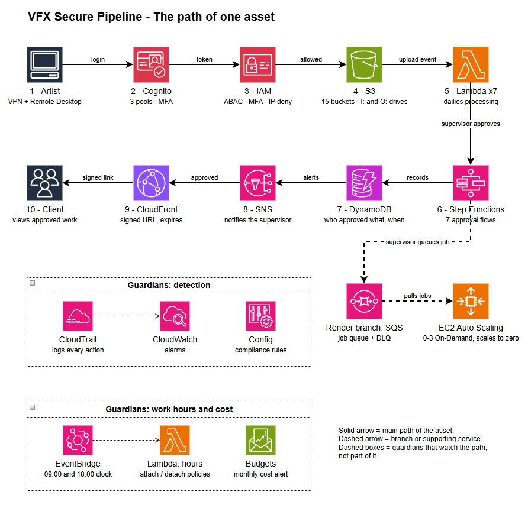

🎬 VFX Secure Pipeline
A security-first cloud pipeline for a VFX studio, built as code on AWS.

Imagine a VFX studio where artists upload work, supervisors review and approve it, and finished shots reach the client, all without a single file leaving a controlled, audited environment. This project builds that whole journey as code, with security at every step instead of added at the end.

💡 In plain words: it's the digital backbone of a studio. It decides who can touch which file, when, and from where, and it raises an alarm when something looks wrong.
Portfolio project by Diego Ortiz. Built with Terraform on AWS (free tier plus a $100 credit account).

🧭 How this project was built
1. Phase 1, local: the whole design was first built and tested against Floci, a local AWS emulator, so mistakes cost nothing. That work lives in the main branch and is closed.
2. Phase 2, real AWS (this branch, aws-real): the same design was deployed to a real AWS account, adapted to what a real account actually allows, and tested with real test users.

🤖 Transparency: I designed the architecture and made every decision, but I'm new to writing infrastructure code. I used Claude (AI) to generate the Terraform and commands, then ran, tested and debugged everything myself.

## 🗺️ Architecture

*The numbered diagram follows an asset from the artist's upload to the client's approval.*

🧱 The nine blocks
Each block is described by what it does in the real AWS account.

🌐 01 · Network
One private network with a separate subnet and firewall (NACL) per department, plus security groups.
💻 Technical: VPC, 6 department subnets + Render Final + Client Review, 6 NACLs, 8 security groups, S3 and SQS endpoints.
🚀 Designed and deployed. The access boundary I actually tested is identity-based (see block 03).

🗄️ 02 · Storage
Where the files and their records live. Files are versioned and encrypted; every version gets a readable record (who, when, status).
💻 Technical: 15 S3 buckets (SSE-S3 encryption, public access blocked, versioning on input/output) and 7 DynamoDB tables.

🔐 03 · Identity
Who you are decides what you can touch. Four roles (Artist, Lead, Department Supervisor, VFX Supervisor), mandatory MFA, access limited by working hours and by office IP, and extra overtime permissions granted by a supervisor.
💻 Technical: attribute-based access control (ABAC) with tags, no IAM groups (blocked by the organization), Cognito pools for staff, clients and guests, a scheduler Lambda for overtime.
✅ Verified with real test users: IP restriction, ABAC, MFA for artists and supervisors, overtime tagging.

⚙️ 04 · Automation
The approval journey as one visible workflow instead of loose scripts: the supervisor's decision, version naming, notifications, and automatic review videos and images.
💻 Technical: 7 Step Functions approval flows, SNS notifications, 7 Lambdas that generate dailies (video with FFmpeg, images).
✅ Verified: all 7 flows and all 7 Lambdas run end to end. Approval flows are started manually by design.

📬 05 · Queue
Render jobs wait in line, so approval and rendering don't depend on each other.
💻 Technical: SQS queue with a dead-letter queue.

🖥️ 06 · Render Farm
A scalable pool of render machines that turns on only when there is work.
💻 Technical: launch template, Auto Scaling Group (desired 0), On-Demand instances because Spot is blocked by the organization.
📐 Designed as a production pattern: the real render workload is not run here.
✅ Verified: a real instance launch.

🚨 07 · Audit & Alarms
Every action is recorded, and alarms watch for suspicious patterns: off-hours activity, denied access, large downloads, function errors.
💻 Technical: CloudTrail, CloudWatch metric filters and alarms, SNS alerts.
⚠️ Declared limit: data events are logged for output and delivery buckets, not for input buckets.

🎞️ 08 · Client Review
Clients watch deliveries through short-lived signed links, with no AWS account needed. A read-only guest role lets recruiters look around safely.
💻 Technical: CloudFront with signed URLs and a private bucket.
🚀 Designed and deployed. Signed-URL generation is not yet tested on the real account.

📊 09 · Governance & Cost
Rules that check the infrastructure itself, and a budget that keeps spending visible.
💻 Technical: AWS Config rules, a $20/month budget managed in Terraform, tagging.
📐 Designed, not deployed: GuardDuty (blocked by the organization).

| Status | What |
|---|---|
| ✅ **Verified on the real account** | IAM by tags (ABAC), MFA for artists and supervisors, IP restriction, supervisor working-hours rule, 7 approval flows, 7 dailies Lambdas, real render-farm instance launch, security alarms |
| 🚀 **Deployed** | All nine blocks, per-department subnets and NACLs, client review with CloudFront, AWS Config |
| 📐 **Designed** | Production render workload, GuardDuty, S3 locked to the private network, client review with a signed-URL end-to-end test |

🧪 Real-account lessons
A real account has guardrails you can't see until you hit them. This one sits under an organization policy (SCP) that blocks IAM groups, Spot instances and GuardDuty. The method: read the error, tell an organization block from my own policy, isolate it with a dry run, and keep the intended design in the code.

🎥 Demo: remote workstation access

Coming soon. The demo shows secure remote access for one department (FX), not the whole pipeline.

⚠️ Declared limits

1. Approval flows are triggered manually and don't validate S3 contents.
2. The render farm is a design, not a production workload.
3. Department subnets are deployed, but the tested access boundary is identity (IAM tags).
4. CloudTrail data events are not enabled on input buckets.
5. The external review tool for clients is not built in AWS.

📦 FFmpeg binaries (not included)
The video Lambdas use an FFmpeg layer. The binaries are over 100 MB, so they aren't in the repo. To rebuild:
1. Download a static FFmpeg build for Linux x86_64 (BtbN FFmpeg Builds).
2. Copy the ffmpeg binary to ffmpeg-layer/bin/ffmpeg.
3. Zip the ffmpeg-layer folder as ffmpeg-layer.zip.
4. Place it in 04-Automation/layers/, then run terraform plan and terraform apply.

🛠️ Tools and why
Each tool choice is documented with the alternatives considered and the reason behind it. Highlights: Terraform over CloudFormation (multi-cloud, portable skills), Lambda with FFmpeg over MediaConvert (cost), Step Functions over chained Lambdas (visibility), OpenVPN over WireGuard for the demo (real user accounts, corporate standard).

📄 License MIT